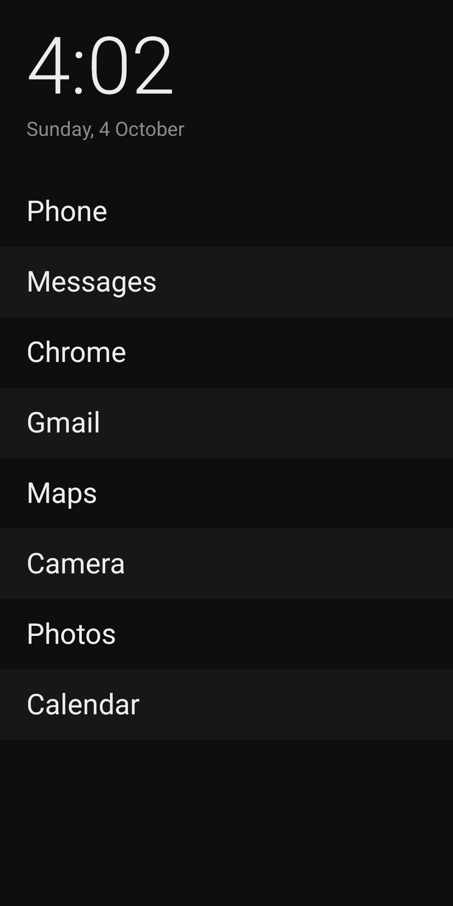
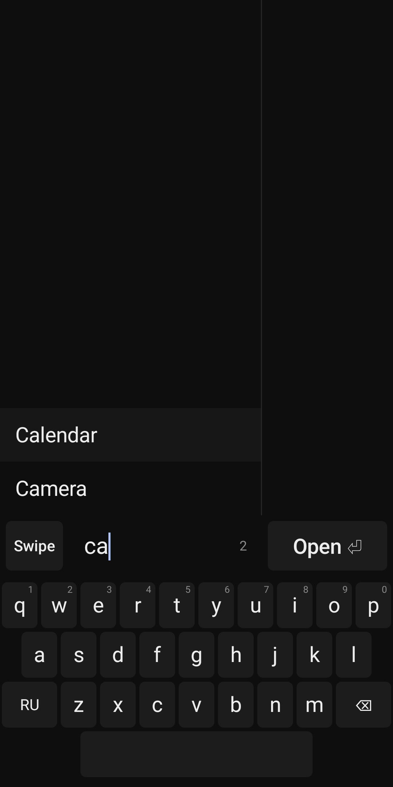
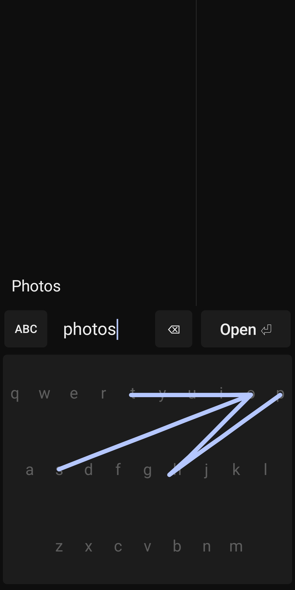
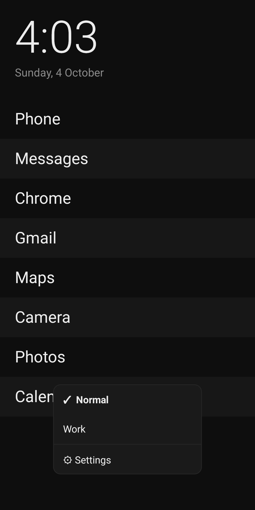

# Mushin Launcher

A minimalist text launcher for Android that gets you to the right app in one touch and nothing more.

<p>
  
  
  
  
</p>

## Why

- **A grid of colourful icons invites aimless launches.** Mushin shows a short list of names with muted icons. No feeds, widgets, badges or ads.
- **System search is slow to open.** The keyboard slides in with an animation, and a swipe down fights with the notification shade. Mushin opens search with its own keyboard, instantly.
- **The apps you need depend on where you are.** Work, home and travel each have different apps, and a single home screen cannot hold them all.

## Highlights

1. **Draw to launch.** Trace a word over the invisible keyboard, or draw any shape right on the home screen. Mushin recognises the app by the shape of the line, even when it is sloppy or off to the side. It learns your drawings on the device, and you can review or erase them in Memory.
2. **Spaces.** Separate app lists for each context: a normal space, a work space and up to 20 of your own. Each has its own palette and its own home list. Long-press the background to switch.
3. **Instant, forgiving search.** Double-tap the background and the built-in keyboard is already there, with no system keyboard lag. Search matches prefixes, substrings and initials. It tolerates typos, the wrong keyboard layout and transliteration: «слак» finds Slack.
4. **Search on top of any app.** Set Mushin as the digital assistant to open search with the assistant gesture, or add the Quick Settings tile.
5. **Offline by design.** The app has no internet permission, so it cannot send anything anywhere. The build fails if a dependency tries to add it. No analytics, no ads, no backups of your data.

## Install

Requires Android 13 or newer.

1. Download the APK from [Releases](https://github.com/mushinlab/mushin-launcher/releases/latest) and install it.
2. Open Mushin Launcher and agree to make it your home app. You can change this later in Settings → Apps → Default apps → Home app.

To verify the download, check that the signing certificate matches the SHA-256 fingerprint published in the release notes:

```
apksigner verify --print-certs mushin-launcher-<version>.apk
```

## Build

JDK 17 or newer and the Android SDK are required.

```
./gradlew assembleDebug                         # debug build
./gradlew testDebugUnitTest test                # unit tests
./gradlew assembleRelease                       # release, unsigned unless keystore.properties exists
```

To sign a release, put `keystore.properties` in the project root with `storeFile`, `storePassword`, `keyAlias` and `keyPassword`. The file is ignored by git.

Requirements, decisions and the changelog live in [`docs/`](docs/). Most of them are in Russian.

## Privacy

Mushin Launcher collects no data. Everything stays on your device. See the [privacy policy](docs/release/privacy-policy.md).

## License

Copyright 2026 Mushin Lab. Licensed under the [Apache License 2.0](LICENSE).

Fonts Inter, Montserrat and Open Sans are under the SIL Open Font License 1.1 ([licenses](core/ui/src/main/assets/licenses/)).
